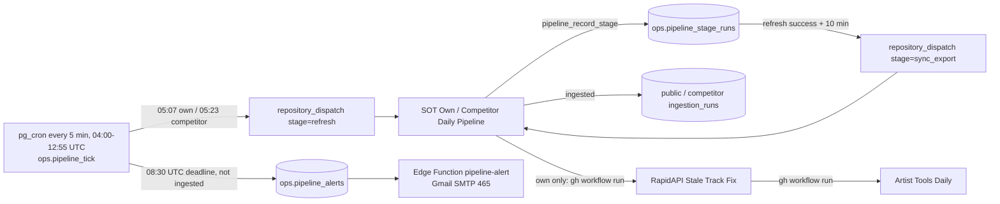

# Daily data pipeline

The daily SpotOnTrack pipeline is started and supervised by the Supabase database
(pg_cron), not by GitHub schedules. GitHub starts cron jobs on this repo 5-7 hours
late (Oct 2026: a 05:07 UTC cron started at 11:06-12:12 UTC), so data used to land
between 14:30 and 18:00 UTC. A `repository_dispatch` request starts a workflow
within seconds. Own-catalog and competitor pipelines stay separate: separate
workflows, concurrency groups, configs, dispatch event types and Supabase schemas.

## How a day runs

| Step | Own catalog | Competitor |
| --- | --- | --- |
| Refresh dispatched | 05:07 UTC (09:07 Dubai) | 05:23 UTC (09:23 Dubai) |
| Sync + export dispatched | 10 min after refresh reports success | same |
| Deadline alert | 08:30 UTC (12:30 Dubai) | 08:30 UTC |
| GitHub fallback (`stage=full`) | 09:00 UTC cron | 09:30 UTC cron |

The two universes share one SpotOnTrack login, so their starts stay 16 minutes apart.

- **Workflows:** `sot_own_daily_pipeline.yml` and `sot_competitor_daily_pipeline.yml`.
  Each listens for `repository_dispatch` (`own-pipeline` / `competitor-pipeline`) with
  `client_payload: {stage: refresh|sync_export, run_date}`, plus `workflow_dispatch`
  (stage `full|refresh|sync_export`) and a late fallback cron that runs `full`.
  Shared setup lives in `.github/actions/sot-setup`.
- **Waiting:** the scheduler waits for SpotOnTrack to process the refresh, so no runner
  sleeps. Only `stage=full` (manual or fallback) sleeps 600 s before syncing.
- **Progress:** each job calls `scripts/pipeline_record_stage.sh`, which posts
  `started|success|failure|skipped` to the service-role RPC `pipeline_record_stage`.
  It never fails a job. Dry runs record nothing.
- **Idempotent:** a precheck skips the run when that universe's `ingestion_runs` already
  has a success for the run date (unless `force_reingest`).
- **Retries (scheduler):** refresh is re-dispatched once after a failure or after 45 min
  without success; sync/export once after a failure (15 min later), after 60 min without
  a start, or after 150 min stuck in `started` (killed runner).
- **Alerts:** one email per problem per day: data not ingested by the deadline,
  GitHub rejecting a dispatch (expired/missing token), or a missing token. Workflow
  steps still email their own failures via `.github/actions/notify-email`.

Configuration lives in `ops.pipeline_config` (enable flag, times, wait, deadline,
attempt limits). Orchestration state is in `ops.pipeline_stage_runs`,
`ops.pipeline_dispatches` and `ops.pipeline_alerts`. The `ops` schema is not exposed
to the Data API. Migration: `supabase/migrations/20261011020521_add_db_orchestrated_pipeline.sql`.

## Setup (owner, once)

1. Create a fine-grained GitHub token for `niksaxena1/StreamBase` with
   **Contents: read & write** and **Actions: read & write**, then in the Supabase SQL
   editor: `select vault.create_secret('<token>', 'github_dispatch_pat', 'StreamBase pipeline dispatch');`
   To rotate: `select vault.update_secret((select id from vault.secrets where name = 'github_dispatch_pat'), '<new token>');`
2. Supabase dashboard → Edge Functions → Secrets: `NOTIFY_SMTP_PASSWORD` (Gmail app password).
3. Deploy the alert function: `supabase functions deploy pipeline-alert --no-verify-jwt`.
   It takes no input and only sends rows already queued in `ops.pipeline_alerts`.
4. After the new workflows are on `main` (`repository_dispatch` only fires there):
   `update ops.pipeline_config set enabled = true;`

## Manual runs and recovery

- Re-run a day: Actions → SOT Own/Competitor Daily Pipeline → Run workflow, `stage=full`
  (or `sync_export` if the refresh already happened), optional `run_date`, and
  `force_reingest` to overwrite an existing ingestion.
- Check scheduler state: `select * from ops.pipeline_stage_runs where run_date = current_date order by created_at;`
  and `select * from ops.pipeline_dispatches where run_date = current_date;`
- Pause automation: `update ops.pipeline_config set enabled = false;` (the GitHub fallback crons still run).
- The old per-stage workflows (`sot_daily_playlist_refresh.yml`, `sot_daily_dashboard_sync.yml`,
  `sot_daily_export.yml` and the competitor equivalents) are manual-only and share the new
  pipelines' concurrency groups. The old export's sync gate looks for runs of the old
  dashboard-sync workflow, so run the old ones in order or use the new pipeline instead.
  The old ingestion watchdog workflows are manual-only; the database deadline check replaces them.

## artist.tools second source and stale fallback

The own-export dispatch starts the stale fixer only for an export dated UTC today.
Successful historical manual re-ingestions do not dispatch today's repair jobs.

Artist Tools Daily is dispatched by `RapidAPI Stale Track Fix` on any completion (the stale fix is started by the own pipeline after a real ingest)
and also has a daily 13:17 UTC (17:17 Dubai) cron fallback. It records own-catalog
cumulative counts even
for tracks RapidAPI fixed, then repairs remaining stale tracks without replacing
existing overrides. It retains the fewer-than-500 safety boundary. Only Supabase
URL/service-role secrets are needed; rotating OAuth tokens live in a private table.
Successful UTC-date runs are skipped by the cron and optional 19:00-local Windows
fallback. See [authorization, limits, comparisons and setup](ARTIST-TOOLS-SOURCE.md).

The 13:17 UTC cron and the optional PC task remain as fallbacks.

## Incremental dashboard sync

Both sync workflows restore the latest state under separate cache prefixes:
`sot-sync-state-own-` / `sot-sync-state-competitor-`. They pass
`--state-file .sync-state/own.json` / `--state-file .sync-state/competitor.json` and
provide Spotify client credentials and Supabase service-role credentials from the
existing repository secrets. A missing cache leaves the script to initialize its
state. Each run saves state after sync with an `always()` condition, including
partial progress on failure, under a key ending in its `github.run_id`.
See [saving caches after failures](https://github.com/actions/cache/tree/main/save#always-save-cache).

The sync script supports `--state-file` and `--full`. The workflow adds
`--full` on Sundays UTC or when its manual boolean input `full_sync` is true.
Other days use the script's incremental behavior. Cache entries are immutable;
rerunning the same run ID can restore its existing entry but cannot overwrite it.

## Other scheduled workflows

These scheduled workflows run independently of the SpotOnTrack completion chains:

- Spotify enrichment runs at 10:29 UTC (14:29 Dubai) on odd UTC calendar days; competitor enrichment runs at 11:09 UTC (15:09 Dubai) on even UTC calendar days.
- Spotify Takedown Watch runs daily at 04:37 UTC (08:37 Dubai), and Spotify Playlist Watch Daily runs daily at 15:11 UTC (19:11 Dubai).
- Artist image refresh is scheduled Fridays at 15:00 UTC (19:00 Dubai). Its job guard limits scheduled runs to UTC dates 1–7, so it runs on the month's first Friday. Manual dispatches bypass the date guard.
- Pipeline Quality CI runs on matching pull requests and pushes to `main`; it has no cron.

## Watchdogs

The own and competitor ingestion watchdog workflows are manual-only; they do not
run on daily schedules. The Supabase database scheduler checks ingestion status
and sends the 08:30 UTC deadline email when a successful run is missing. The
manual workflows remain available for diagnosis. They normalize list, object,
empty, malformed, and error responses before reporting ingestion status; unknown
stale counts are informational.

## Other scheduled jobs (database-dispatched, since 2026-10-12)

GitHub's own `schedule:` triggers ran 6–8 hours late, so these workflows are started by pg_cron through
`ops.dispatch_workflow(<file>)` (GitHub `workflow_dispatch`, same vault token as the pipeline). Times are UTC.

| Job | pg_cron name | When |
|---|---|---|
| `spotify_takedown_watch.yml` | `streambase-takedown-watch` | 04:37 daily |
| `artist_tools_daily.yml` | `streambase-artist-tools-daily` | 13:17 daily |
| `spotify_playlist_watch_daily.yml` | `streambase-playlist-watch` | 15:11 daily |
| `spotify_artist_image_refresh.yml` | `streambase-artist-image-refresh` | 15:00 on the first Friday of the month |

`ops.check_workflow_dispatches()` (every 15 min) records GitHub's reply in `ops.workflow_dispatches` and emails
once per workflow per day if GitHub did not answer 204. `ops.check_db_size()` (04:00 daily) emails at most
weekly while the database is above 450 MB (Free plan limit 500 MB). Manual runs: GitHub Actions → Run workflow,
or `select ops.dispatch_workflow('<file>.yml', '{"input":"value"}');`.
